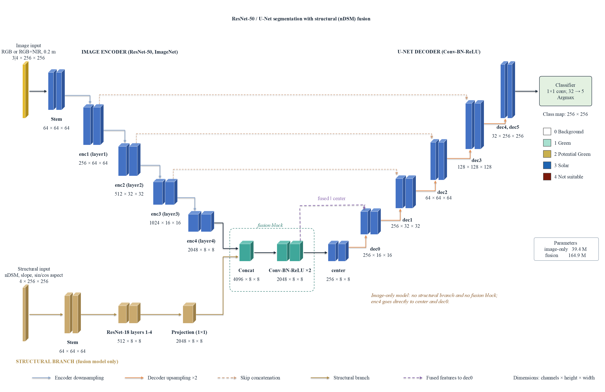

# Modified-Roofpedia

### Structure-aware four-class rooftop mapping for Swiss cities

> A pipeline building on [Roofpedia](https://github.com/ualsg/Roofpedia). It maps existing green roofs, solar roofs, potential green roofs and unsuitable flat roofs from orthophotos, and fuses the imagery with elevation-derived layers from swisstopo.

---

## Overview

Modified-Roofpedia extends the Roofpedia segmentation workflow in four ways.

1. **Four roof classes in one network.** Roofpedia uses separate binary networks for green and solar roofs. This pipeline predicts background plus four classes in a single U-Net:
   - **Green (G):** existing vegetated roofs (extensive or intensive).
   - **Potential Green (PG):** bare flat roofs, such as gravel or bitumen, on which greening is plausible.
   - **Solar (S):** flat roofs with PV or solar-thermal installations.
   - **Not Suitable (NS):** flat roofs judged unsuitable from visible material or use, such as glass roofs, terraces, parking decks or dense technical equipment.
2. **Structural fusion.** A second encoder processes four elevation-derived layers: nDSM, slope, sin(aspect) and cos(aspect). Its features are fused with the image features at the bottleneck of the U-Net.
3. **Per-building coverage fractions.** Each building footprint stores the predicted share of every class, in addition to a single dominant-class label.
4. **Spatially blocked evaluation.** Training, validation and evaluation tiles are separated by spatial blocks, so accuracy is reported on unseen areas.

> **Change from the previous version:** the slope filter is no longer applied. Slope, aspect and nDSM are now model inputs. A mean-slope threshold of 6.5° excluded about 95% of manually labelled flat roofs in Bern, because the footprint mean includes steep gradients at walls, eaves and parapets.

## What's new compared to Roofpedia

| Aspect | Roofpedia | Modified-Roofpedia |
|---|---|---|
| Output | Two binary networks (green, solar) | One network, background + 4 classes |
| Inputs | RGB imagery | RGB (or RGB + NIR) imagery + nDSM, slope, aspect |
| Architecture | U-Net, ResNet-50 encoder | Dual-encoder U-Net: ResNet-50 image encoder + ResNet-18 structural encoder, bottleneck fusion |
| Building label | Binary | Dominant class + per-class coverage fractions |
| Evaluation | Random tile split | Spatially blocked split (8 × 8 tile blocks) |
| Geographic focus | Global cities | Swiss cities (tested in Bern) |

## Model architecture


<!-- TODO: add the figure to docs/ or update this path -->

- **Image encoder:** ResNet-50 pretrained on ImageNet. For four-band input (RGB + NIR), the first convolution is widened and the NIR filters are initialized with the mean of the pretrained RGB filters.
- **Structural encoder:** ResNet-18 pretrained on ImageNet, with a four-channel first convolution initialized the same way. A 1 × 1 convolution projects its 512-channel output to 2,048 channels.
- **Fusion block:** the image and structural bottleneck features (each 2,048 × 8 × 8 for a 256 × 256 tile) are concatenated and passed through two 3 × 3 Conv-BN-ReLU blocks (4,096 → 2,048 → 2,048).
- **Decoder:** U-Net decoder with Conv-BN-ReLU blocks. Skip connections come from the image encoder only.
- **Output:** 1 × 1 convolution to 5 channels (background + 4 classes), argmax per pixel.
- **Parameters:** 39.4 M image-only, 164.9 M fusion.

The image-only baseline is the same network without the structural encoder and fusion block.

## Data

| Dataset | Use | Access |
|---|---|---|
| [SWISSIMAGE 10 cm](https://www.swisstopo.admin.ch/en/orthoimage-swissimage-10) | RGB imagery (recommended) | Open (OGD) |
| [SWISSIMAGE RS](https://www.swisstopo.admin.ch/en/orthoimage-swissimage-rs) | NIR-RGB imagery (optional) | On request from swisstopo, cost offer |
| Mapbox satellite tiles | RGB imagery (optional) | API key, free monthly quota |
| [swissTLM3D](https://www.swisstopo.admin.ch/en/landscape-model-swisstlm3d) | Building footprints | Open (OGD) |
| [swissSURFACE3D Raster](https://www.swisstopo.admin.ch/en/height-model-swisssurface3d-raster) | DSM (0.5 m) | Open (OGD) |
| [swissALTI3D](https://www.swisstopo.admin.ch/en/height-model-swissalti3d) | DTM (0.5 m) | Open (OGD) |

SWISSIMAGE 10 cm with the swisstopo elevation models is the only configuration that is fully reproducible from open data.

**Note on SWISSIMAGE RS:** the delivered GeoTIFFs tag the fourth band (blue) as an alpha channel. GIS tile exporters then treat it as transparency, which produces washed-out tiles and drops the NIR band. Read every band as data and mosaic on the native 0.1 m grid before warping to the tile grid.

### Structural layers

- nDSM = swissSURFACE3D DSM − swissALTI3D DTM
- Slope and aspect from the DSM (Horn's method)
- Aspect encoded as sin(aspect) and cos(aspect)
- The four layers are resampled bilinearly to each image tile and standardized with per-channel statistics from the training tiles.

### Tiles

All inputs and labels use 256 × 256 slippy-map tiles at zoom level 19 (about 0.2 m per pixel in Bern).

## Installation

```
conda env create -f environment.yml
```

For CPU-only systems:

```
conda env create -f environment_cpu.yml
```

<!-- TODO: confirm these environment files are up to date for the fusion code -->

## Usage

<!-- TODO: fill in the actual script names, arguments and config keys for the fusion pipeline -->

### 1. Prepare imagery tiles

[TODO: command or QGIS steps for generating zoom-19 tiles, and the output folder]

### 2. Prepare structural layers

[TODO: script that computes nDSM, slope and sin/cos aspect and renders them to the tile grid]

### 3. Prepare labels and the spatial split

[TODO: script that rasterizes reference polygons to label tiles and assigns 8 × 8 tile blocks to train / validation / evaluation (70:15:15)]

### 4. Train

[TODO: training command and config file]

Training settings used in the study:

| Setting | Value |
|---|---|
| Optimizer | Adam, learning rate 5 × 10⁻⁴ |
| Batch size | 8 |
| Epochs | 200 |
| Loss | Binary Lovász hinge (as in the Roofpedia implementation) |
| Augmentation | Random 90° rotations and flips (8 variants), applied jointly to image, structural layers and mask |
| Model selection | Highest validation mIoU over the four roof classes |

### 5. Predict and assign building labels

[TODO: prediction command, config keys and output paths]

For each footprint the pipeline stores:

- **Coverage fractions** `p_G, p_PG, p_S, p_NS`: share of predicted pixels of each class inside the footprint.
- **Detected flag:** a building counts as detected if its total roof-class coverage exceeds τ = 0.05.
- **Area-based label:** the class with the largest coverage fraction (recommended).
- **Priority-based label (optional):** the first class present in the order Solar > Potential Green > Green > Not Suitable.

Use the area-based label for inventories and class statistics. The priority rule overstates Solar and Potential Green area and should only be used to answer questions such as "which roofs carry any PV?".

## Results (Bern, held-out evaluation blocks)

Pixel level, 1,346 held-out tiles:

| Model | OA | mIoU | κ |
|---|---|---|---|
| Image-only, SWISSIMAGE | 0.593 | 0.398 | 0.670 |
| Fusion, SWISSIMAGE | 0.601 | 0.426 | 0.708 |
| Image-only, SWISSIMAGE RS | 0.590 | 0.419 | 0.689 |
| Fusion, SWISSIMAGE RS | 0.603 | 0.421 | 0.710 |
| Image-only, Mapbox | 0.591 | 0.411 | 0.678 |
| Fusion, Mapbox | 0.602 | 0.426 | 0.705 |

Building level, 1,186 held-out buildings: overall accuracy 65.0% to 67.5% for all six configurations. Fusion improves pixel-level κ for every imagery source, but the building-level difference is not statistically significant.

City-scale application (SWISSIMAGE fusion network) flagged 12,611 candidate flat-roof footprints: 4,489 Green, 3,894 Potential Green, 999 Solar and 3,229 Not Suitable.

## Limitations

- **Potential Green is a screening class.** Load-bearing capacity is not available as open data and is not considered. Candidates need a structural assessment.
- **Trained on flat roofs only.** Behaviour on pitched roofs is not characterized. Detections outside the reference set are not verified.
- **One city.** The model was trained and evaluated in Bern only.
- **Coverage fractions** have limited validation, because most reference roofs are labelled with a single class.

## Pretrained models

Please contact [Htet Yamin Ko Ko](mailto:htetyaminkokoedu@gmail.com) for the trained models and supplementary data.

## Citation

[TODO: add the paper reference once it is published]

## Acknowledgements

This project builds on:

- **Roofpedia** by [Abraham Noah Wu](https://ual.sg/authors/abraham/) and [Filip Biljecki](https://ual.sg/authors/filip/), Urban Analytics Lab, National University of Singapore.
  Wu AN, Biljecki F (2021): Roofpedia: Automatic mapping of green and solar roofs for an open roofscape registry and evaluation of urban sustainability. *Landscape and Urban Planning* 214: 104167. [doi:10.1016/j.landurbplan.2021.104167](https://doi.org/10.1016/j.landurbplan.2021.104167)
- **SWISSIMAGE, swissTLM3D, swissSURFACE3D and swissALTI3D** by [swisstopo](https://www.swisstopo.admin.ch/), the Swiss Federal Office of Topography.
- The **Swiss Territorial Data Lab (STDL)** for providing SWISSIMAGE RS data for Bern.

### Packages

- [PyTorch](https://pytorch.org/)
- [GeoPandas](https://geopandas.org/)

## License

Distributed under the MIT License. See `LICENSE` for more information.

## Contact

Htet Yamin Ko Ko, International Space Science Institute (ISSI), Bern, Switzerland. htetyaminkokoedu@gmail.com
